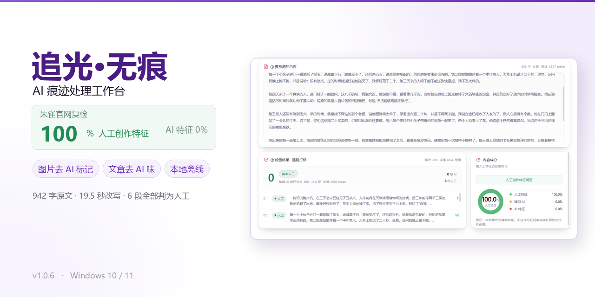
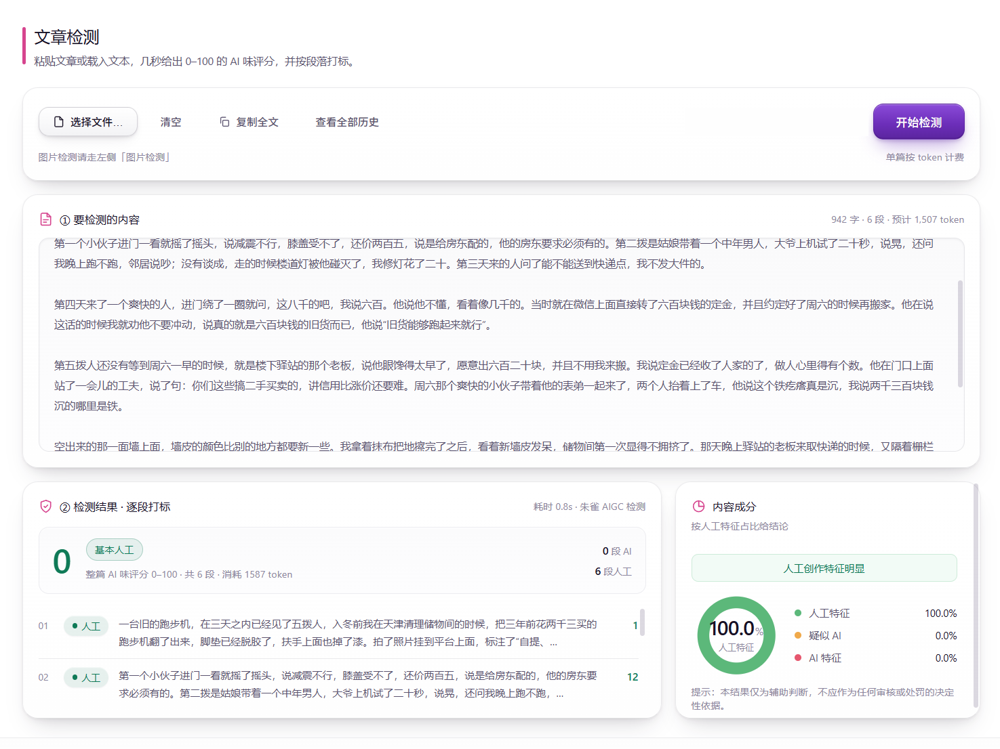
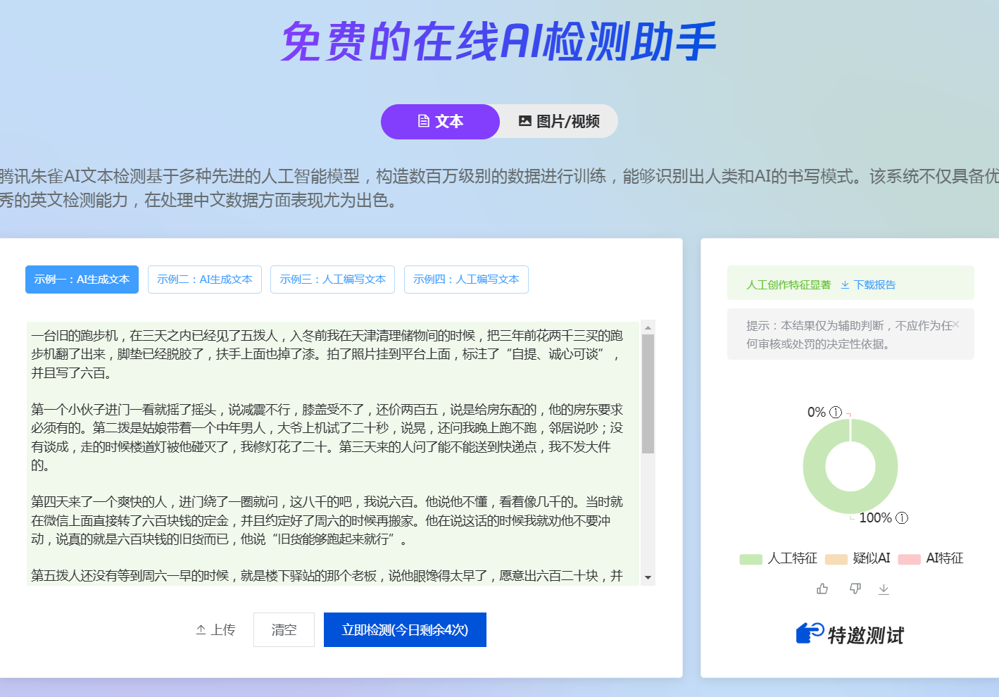
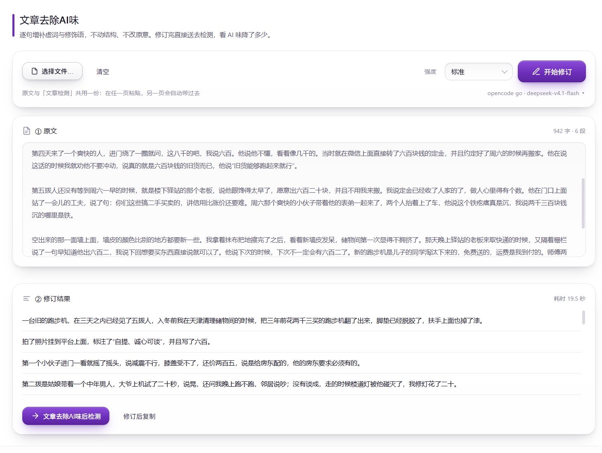
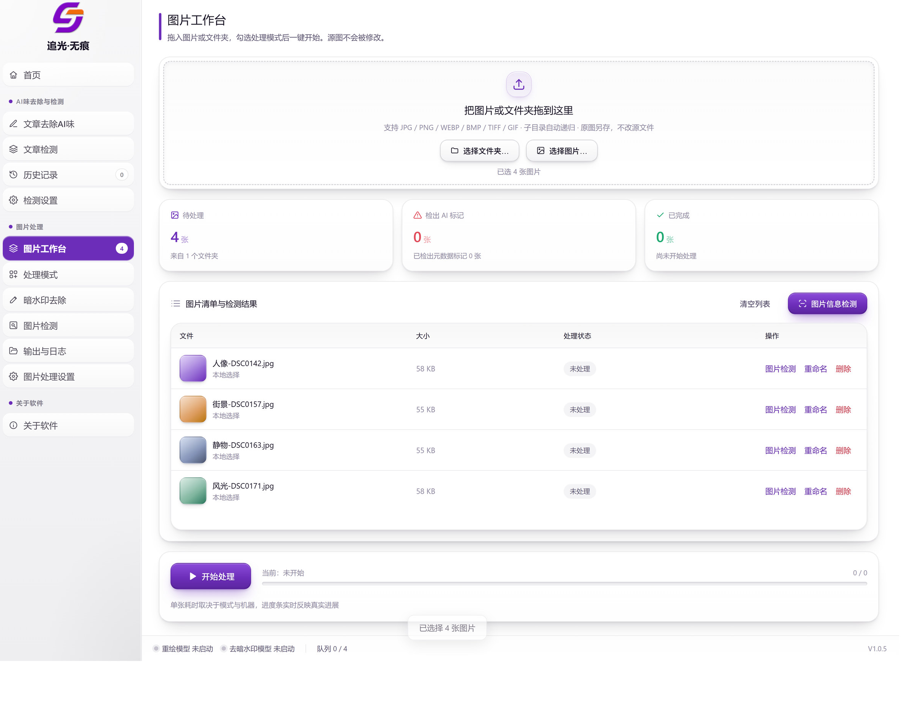
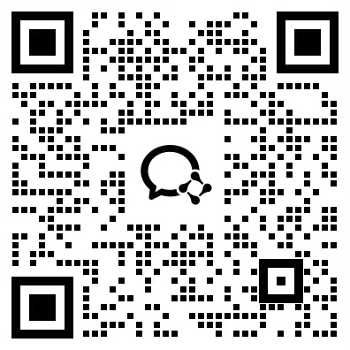

# 追光·无痕

**AI 痕迹处理工作台 · 图片去 AI 标记 / 文章去 AI 味 · 本地运行**

纯本地运行的 Windows 桌面软件 · 本仓库仅作产品介绍与使用说明，不含源代码与安装包

---

## 目录

[先看效果](#先看效果) · [这是什么](#这是什么) · [下载与安装](#下载与安装) · [文字处理](#文字处理) · [图片处理](#图片处理) · [系统要求](#系统要求) · [常见问题](#常见问题) · [使用须知](#使用须知) · [进群交流](#进群交流)

---

## 先看效果

同一篇 **942 字、6 段**的原文，软件改写用时 **19.5 秒**；改完立刻送检，两个独立系统给出同一个结论：

<table>
<tr>
<td width="50%" align="center" valign="top">

<strong>软件检测：人工创作特征 100.0%</strong> 
6 段全部判为人工 · AI 味总分 0

</td>
<td width="50%" align="center" valign="top">

<strong>腾讯朱雀官网复检：人工创作特征 100%</strong> 
疑似 AI 0% · AI 特征 0%

</td>
</tr>
</table>

右边那张是腾讯朱雀的官方检测页面。同一段文本，两个独立系统给出同一个结论，可以拿原文到官网自行复现，不是软件自说自话。

左侧是原文，右侧是修订结果。逐句调整表达方式，**段落数量、叙事顺序、原意都没有动** —— 这不是重写，是改写。

---

## 这是什么

「追光·无痕」是一个纯本地运行的 Windows 桌面软件：把图片里 AI 生成留下的痕迹洗掉，把文章里那股 AI 味测出来并改掉。**图片全程不出本机**，只有「文章检测」和「文章去除 AI 味」需要联网调用接口。

一句话：一个窗口管两件事 —— 图片去痕迹，文章去 AI 味。

| 模块 | 解决什么 |
| --- | --- |
| 文章检测 | 给一段文字打 0–100 的 AI 味分数，并逐段标出哪几句像 AI 写的 |
| 文章去除 AI 味 | 逐句改写成更像人写的版本，不动结构、不改原意，改完能立刻再测一遍看分数掉了多少 |
| 图片工作台 | 批量清掉图片里的 AI 生成痕迹：元数据、软件签名、暗水印、AI 味画风，还能顺手伪装成相机拍的 |
| 图片检测 | 处理之前先看一眼，这张图的文件里到底有没有留下痕迹、留了几处 |

界面是左边一列菜单、右边一块操作区、底部一条状态栏：

| 菜单分组 | 里面有什么 |
| --- | --- |
| AI 味去除与检测 | 文章去除 AI 味、文章检测、历史记录、检测设置 |
| 图片处理 | 图片工作台、处理模式、暗水印去除、图片检测、输出与日志、图片处理设置 |
| 关于软件 | 首页、关于软件（版本、联系方式、检查更新） |

底部状态栏一直显示两件事：重绘模型、去暗水印模型有没有启动，以及当前队列进度。

---

## 下载与安装

### 下载

| 内容 | 链接 | 提取码 |
| --- | --- | --- |
| 软件包 | https://pan.baidu.com/s/1N0Y8pXUIgxi7bRui9oiCHg?pwd=w84t | `w84t` |
| 重绘模型 | https://pan.baidu.com/s/1fB8UdRCYuMsS8yEuwQsZkw?pwd=iqpq | `iqpq` |
| 去暗水印模型 | https://pan.baidu.com/s/1-85sB5YirKUsfQjFHzvGGg?pwd=pi98 | `pi98` |

> 一般下载软件包就够用了。模型体积较大；电脑配置不够时，重绘可以改用 API 通道。去暗水印模型针对的是海外媒体，国内媒体不检测暗水印，因此通常不需要下载。

### 安装与启动

1. **先解压整个文件夹**。右键压缩包「全部解压缩」，不要只把 exe 拖到桌面 —— 模型和引擎都在旁边的文件夹里，单拿一个 exe 打不开。
2. **双击 `追光无痕.exe`**。首次启动几秒到十几秒都正常，程序要先把自身解开，杀毒软件也可能扫一遍；之后每次启动一到两秒。
3. 窗口出来就算启动成功。没反应时看右下角托盘有没有紫色小图标，双击能唤回窗口；也可以查任务管理器里有没有「追光无痕」。
4. **点右上角 ✕ 不是退出**，只是收进托盘，程序继续跑，正在处理的图不会中断。要彻底退出，右键托盘图标选「退出」。
5. 软件启动后会在本机开一个服务，浏览器访问 `127.0.0.1:8765` 也能得到同样的界面，这个地址只对你自己的电脑有效。

解压后这些文件和 exe 必须在同一层：

| 必须同层的东西 | 作用 |
| --- | --- |
| `追光无痕.exe` | 程序本体，双击这个 |
| `重绘模型\`、`去暗水印模型\` | 两个本地模型（重绘那套约 6.65 GB），A 模式和 E 模式用；缺一个对应功能就用不了 |
| `web\` | 全部界面文件，缺了会白屏 |
| `exiftool\`、`runtime\`、`assets\` | 元数据读写工具、随程序携带的运行环境、图标资源 |

> 打不开基本都是这两个原因：只拿了 exe 没带资源文件夹，或者解压在被压缩软件锁住的临时目录里。把整个文件夹放到 D 盘或 E 盘、路径里别有特殊符号，再试一次。

---

## 文字处理

### 文章检测

把文字粘进上方编辑区，点「开始检测」；也可以点「选择文件…」导入 `.txt` 或 `.md`。两千字左右的文章，十几秒到半分钟出结果。

| 结果区域 | 看什么 | 怎么用 |
| --- | --- | --- |
| 总分与分级 | 一个大数字，0–100，越低越像人写的 | 决定要不要改、改几遍 |
| 逐段打标 | 每段一行，带分数和标签 | 标「疑似 AI」的段落机器味最重，优先动这几段 |
| 内容成分 | 按人工特征、疑似 AI、AI 特征三块摊开占比 | 主要看趋势：改完一版再测，看 AI 那块有没有缩小 |

分数对应的判断口径，记四档就够：

| 分数 | 分级 | 怎么处理 |
| --- | --- | --- |
| 20 分以下 | 基本人工 | 不用改，直接发 |
| 20–50 分 | 轻微 AI 味 | 挑分数最高的两三段改口语化即可 |
| 50–80 分 | 明显 AI 味 | 整体走一遍「文章去除 AI 味」 |
| 80 分以上 | 高度疑似 | 结构多半也是 AI 骨架，改写后必须复测 |

结果页还有两个顺手的动作：「复制全文」把原文整段带走；「查看全部历史」跳到历史记录，每次检测都能回看还原。默认每测一篇自动存一条，可以在「检测设置」里关掉。

> **分数是概率判断，不是判决书。** 同一篇换个平台、换个时间测都可能变。它适合判断「要不要再改一遍」，不适合拿来当证据指认谁用了 AI。

### 文章去除 AI 味

逐句补虚词、补修饰，不动结构不改原意，改完直接送检测对比分数。

1. 把原文粘进「① 原文」，或点「选择文件…」导入。
2. 顶部选强度，第一次建议用「标准」。
3. 点「开始修订」。两千字大概一到三分钟，右上角显示当前模型，点它能跳到检测设置换模型。
4. 结果在下方「② 修订结果」，左原文右改写，逐句对着看；改歪的句子直接在框里手改。
5. 满意了点「修订后复制」；想验效果，点「文章去除 AI 味后检测」，改后的版本会直接送检，两个分数一对比就知道掉了多少。

| 强度 | 改动幅度 | 适合 |
| --- | --- | --- |
| 标准 | 中幅，保住原文说法与节奏 | 公众号、小红书文案的默认档，多数情况选这个 |
| 强效 | 大幅，句式改写更多 | 分数 80 以上、或平台对 AI 味卡得很紧时；改完必须逐句过一遍 |

原文框和「文章检测」页共用一份：在检测页粘过的文字，切到这一页会自动带过来。

### 检测设置：两个 Key

上半块管改写的模型接口，下半块管朱雀检测 Key，别填混。

先在「服务商」下拉选一家，Base URL 和模型名会自动填好，之后仍可手改；填 API Key，点「保存模型设置」，再点「测试连接」确认通。

| 服务商 | 默认模型 | 说明 |
| --- | --- | --- |
| opencode go | deepseek-v4.1-flash | 程序默认档，开箱可用 |
| 千问 | qwen3.8-flash | 改写质量更好，速度快也便宜 |
| DeepSeek | deepseek-flash | 建议关掉思考，否则 token 全被思考吃掉 |
| 豆包（火山方舟） | 控制台里的接入点 ID | 模型名要填已开通的推理接入点 |
| 智谱 GLM | glm-5.3 | 地址带 `/api/paas/v4`，别少写 |
| 自定义 | 自己填 | 任何 OpenAI 兼容接口：填 Base URL、Key、模型名即可 |

- 「获取模型」会去问服务商的 `/models` 列表，避免手填错模型名。
- `max_tokens` / `temperature` / 单次超时一般不动；长文改写把 `max_tokens` 和超时调大。
- 开启思考模式不建议：单篇慢约十倍，只在朱雀测出人工占比低于 50% 时才值得试。

下半块是朱雀 Key：在腾讯 EdgeOne Makers 控制台申请，填进「朱雀 Key（文本检测）」，保存后点「测试连接」。朱雀每月送 50 万 token，大约能检测 1000 篇文章（[申请说明](https://cloud.tencent.com/document/product/1552/137539)）。这块只管文章检测，按 token 计费。

> 填过的 Key 不明文回显，只显示后四位；换 Key 直接输新的点保存，留空表示不修改。

### 历史记录

检测和修订都自动存这里，能搜、能回看、能导出：按标题或正文片段搜索，可按时间或分数排序；「回看」把那次结果整个还原（修订记录会还原原文和逐句对照）；还能重命名、单条删除、导出 JSON 备份。历史存在程序目录的 `data\zhuiguang_history.json`，整个文件夹拷走，历史跟着走。

---

## 图片处理

### 图片工作台

拖进来、勾模式、点开始，**源图不动，结果另存一份**。

图片工作台：批量导入、检测、处理、输出，一个界面完成

三种加图方式：直接把图片或整个文件夹拖进虚线框；点「选择图片…」按文件挑；点「选择文件夹…」连子文件夹一起加进来，目录结构自动保留。支持 JPG / PNG / WEBP / BMP / TIFF / GIF，单张上限 32 MB，超出的自动跳过并提示。

清单上的「处理状态」会写清这张图实际跑了哪几步，比如 `A→C` 就是重绘加清元数据都走了；行尾「图片检测」可单张查痕迹，「删除」只从列表移除、不动硬盘文件。底部「开始处理」是总开关，进度条真实反映跑到第几张；「停止」只在两张图之间生效，正在推理的那张会先跑完，避免文件写到一半。

### 五个处理模式

A 到 D 在「处理模式」页，E 去暗水印是独立页面。开关可以多选、自由组合，勾了哪些就跑哪些。

| 模式 | 做什么 | 什么时候用 | 耗时 |
| --- | --- | --- | --- |
| **A 模型重绘** | 本地 SDXL 按原图重画一遍，Canny 边缘锁结构，AI 纹理被洗掉 | 一眼能看出是 AI 画的，要彻底换画风 | 约 2 分钟 / 张 |
| **B 伪装相机** | 先清空元数据，再写入真实相机的机身、镜头、光圈、快门、ISO 全套参数 | 平台会查拍摄参数，需要合理出处 | 秒级 |
| **C 彻底清除** | 用 ExifTool 把元数据整条剥掉，不写新信息 | 只求干净，不在乎相机信息 | 秒级 |
| **D 画质增强** | 八项图像参数，可逐个开关，能与 A 叠加 | 图偏灰、偏平，想更像照片 | 秒级 |
| **E 去暗水印** | 破坏埋进像素的隐形水印，要 NVIDIA 显卡，在独立页单独跑 | 只在国外平台发布才用得上 | 1 分钟起 / 张 |

常用的组合只有三种，其余都是变体：

| 组合 | 适合什么 | 单张耗时 |
| --- | --- | --- |
| A + B | 日常最快，重绘加伪装，国内平台基本够用 | 约 3 分钟 |
| C + B | 只想过元数据检查，画面一个像素都不动；只清不写就单独跑 C | 几秒 |
| 只勾 D | 只想让画面好看，不涉及去痕迹 | 几秒 |

> 海报、多元素、带大量文字的图，重绘会内容漂移并发糊。这类图建议不重绘，只用 C 清元数据。

- **B 的 13 种相机预设**：iPhone 15/16/17/18 Pro、HUAWEI Mate 70 Pro / Pura 80 Pro、Xiaomi 15 / 15 Ultra、vivo X200 Pro / Ultra、OPPO Find X8 Pro、HONOR Magic7 Pro、OnePlus 13。写入的不只是机型名，还有镜头信息、曝光参数、实际像素尺寸、毫秒时标、内嵌缩略图和 ICC 色彩描述，平台读出来才是一套自洽的参数。
- **D 的八项**：S 曲线、自然饱和、USM 锐化、胶片颗粒、暗角、微色彩偏移、高频细节、背景虚化（可选）。强度三档会重置勾选：轻 3 项、中 6 项、重 7 项，之后仍可单项微调。
- 模式参数里的「重绘来源」可选本地模型或 API 模型（API 通道不启动本地模型）；「拍摄时间」留空沿用文件时间，也能手动指定。

### 去暗水印

擦掉 Google、OpenAI、Meta 埋在像素里的隐形水印 —— 肉眼看不出，平台能读出来。

| 项 | 事实 |
| --- | --- |
| 硬件 | 必须 NVIDIA 显卡；程序先把长边压到 1024 再处理，16 GB 显存够用；没显卡跑不了 |
| 耗时 | 页面标称单张约 1 分钟，实际看显卡，慢的机器十几分钟也可能；重绘加修脸两个阶段串行跑 |
| 适用 | 只针对国外平台的隐写水印（SynthID 一类） |
| 不适用 | 国内平台不检测这种水印，开了只是白等 |

引擎不常驻，点开始才临时加载模型，跑完即释放；含人脸的图强制走修脸阶段，权重缺失时自检会在开始前拦下，不会跑到一半失败。

### 图片检测

只读元数据不看画面 —— 查的是「文件里有没有脚印」，不是「看起来像不像 AI」。七个检测项可以单独勾：AI 生成参数、软件标记、图片内嵌文本、编辑历史、备注内容、内容凭证、AI 水印残留；取消勾的不参与检测，也不计入结论。

可以在「图片工作台」选好图点「图片信息检测」批量查，或在这一页点「重新检测全部」「仅检测选中」。右侧「元数据详情」列出命中的键值，比如 `Software` 一栏写着 `Stable Diffusion XL`，就是最典型的 AI 软件签名。

> 左上角「元数据风险分」的算法是 命中项数 × 18，上限 100，只作参考，不是模型打分。真要看图有没有 AI 味，还得靠肉眼和平台规则。

### 输出与日志

- 默认输出落在桌面，可点「选择输出文件夹…」改到任意目录，点「打开输出文件夹」直接弹资源管理器。
- 页面上的「处理结果」只保留最近 4 张预览，全部结果都在输出文件夹里。
- 下方「处理日志」实时滚动，失败的图来这里看原因，整段可以选中复制。
- 输出默认保持原格式；勾了 A 重绘的一律是 `.jpg`，因为重绘通道只能出 JPEG，程序按真实格式落盘，不会给一个改了后缀的假文件。

### 图片处理设置

通用开关和默认参数都在这，一般不用改，最多改「自动启动模型」：

| 设置项 | 作用 | 建议 |
| --- | --- | --- |
| 处理完成后打开输出文件夹 | 批量任务结束时自动弹出结果目录 | 默认开 |
| 开始处理时自动启动模型 | 勾了 A 就不用手动点「启动模型」，首次加载 20–60 秒 | 默认关，第一次用建议打开 |
| 重绘强度 | 轻 0.28（最像原图）/ 中 0.35（默认）/ 重 0.45（改得最多） | 先中，再按效果微调 |
| 重绘指令 | 追加到内置写实提示词，只影响质感与风格，构图由 ControlNet 锁 | 留空即可 |
| 性别保持 | 按最大人脸判断性别，避免重绘把人画变性 | 自动；识别不准再手动指定 |
| ControlNet 约束强度 | 0.5 / 0.7 / 0.9，越高越保结构但越糊 | 0.7 平衡点 |
| API 图片重绘 | 处理模式选「API 模型」时走的云端通道，Key 填这里 | 只用本地模型就不用管 |

---

## 系统要求

| 项目 | 要求 |
| --- | --- |
| 系统 | Windows 10 / 11（64 位） |
| 显卡 | A 模型重绘、E 去暗水印建议 NVIDIA 显卡；E 需要约 16 GB 显存，没显卡跑不了 |
| 磁盘 | 软件包之外还有两个本地模型，其中重绘模型约 6.65 GB；配置不够可用 API 通道做重绘 |
| 内存 | 建议 16 GB 以上 |
| 联网 | 图片处理全程本地、断网可用；文章检测与改写需要联网调用接口 |

---

## 常见问题

| 现象 | 原因 | 怎么处理 |
| --- | --- | --- |
| 双击 exe 没反应 | 首次启动要解包，或只拷了 exe 没带资源文件夹 | 等 10 秒；看托盘有无紫色图标；都没有就重新解压整个文件夹 |
| 窗口白屏 | 解压不完整，界面文件缺失 | 按 F5 刷新；一直白就重新解压 |
| 提示缺模型 / 缺去水印引擎 | 资源文件夹没跟着走 | 两个模型文件夹必须和 exe 在同一层 |
| 文章检测报错 401 | 朱雀 Key 没填、填错或额度用完 | 到「检测设置」点「测试连接」，它会告诉你卡在哪 |
| 去 AI 味提示次数超限 | 所接的大模型接口有频率限制 | 等一阵再试，或换服务商、换 Key |
| 一张图十几分钟 | 勾了 E，或 A 重绘没吃到显卡 | E 单张一两分钟起属正常；A 约两分钟，明显慢就是显卡没被用上 |
| 点停止没反应 | 停止只在两张图之间生效 | 等正在推理的那张跑完就会停 |
| HEIC 处理不了 | 程序不支持苹果 HEIC | 先用别的工具转成 JPG |
| 关窗口程序还在 | ✕ 只是收进托盘 | 右键托盘图标选「退出」 |
| 处理后还有 AI 标记 | 只跑 C 只清元数据，画面里的可见水印不会消失 | 要动像素得用 A 重绘或 E 去暗水印 |
| 找不到输出文件 | 默认落在桌面 | 到「输出与日志」看路径，或点「打开输出文件夹」 |

---

## 使用须知

- **只处理你自己拍的、或者你有权使用的素材。** 别人的照片、有版权要求的商业图，处理痕迹不能让你获得使用权。
- **AI 检测是概率判断。** 任何平台都是如此；这个工具能把明显的地方处理干净，但不保证过所有平台的所有检测。
- **去暗水印只针对国外平台。** 国内平台的检测方式不同，处理了也不代表能过。
- **先小批量试跑。** 新参数先跑一两张，确认效果和参数都合适，再整批处理。
- **配置与历史都在程序目录。** Key 明文存在 `data\zhuiguang_config.json`，把目录发给别人之前先清空里面的 Key。

---

## 进群交流

使用问题、功能建议与版本更新，欢迎进群交流。

**扫码进群 · 使用交流与版本更新**

进群请备注「GitHub + 无痕」，方便快速对接

---

本仓库仅作产品介绍与使用说明，不含源代码与安装包。软件功能以实际版本为准，请遵守所在平台的内容规则与素材授权要求。

